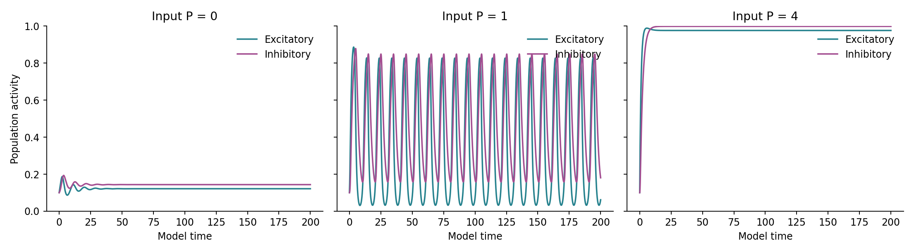
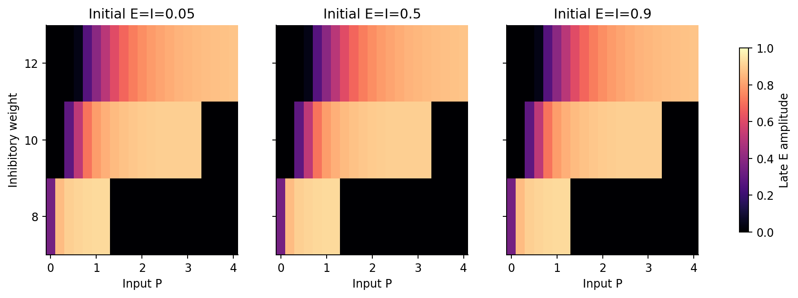
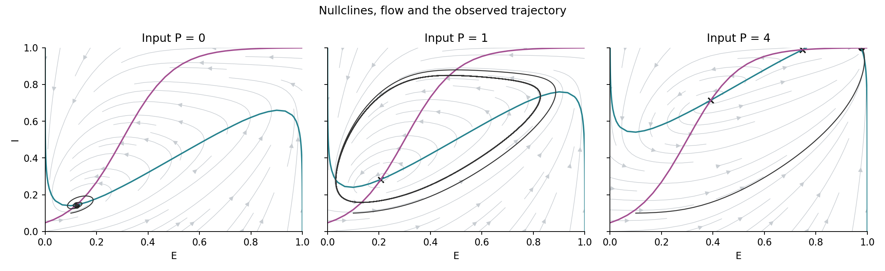

# Excitatory–Inhibitory Population Dynamics

**Steady activity, oscillations and recovery in a two-population rate model.**

I built this experiment to follow a feedback loop: excitation recruits inhibition, inhibition suppresses excitation, and the delay between them can sustain a rhythm. Rather than infer behaviour from a single attractive trace, I compare trajectories, equilibria and local stability across input strengths and starting states.



## The model

With the logistic response F(z) = 1 / (1 + exp(−z)), I integrate

```text
dE/dt = −E + F(12E − wI + P − 2)
dI/dt = (−I + F(10E − 3)) / 2
```

E and I are dimensionless population activities, P is external input and w sets inhibitory feedback. Time is in model units. This is a simplified Wilson–Cowan-style model, not a fitted brain recording.

## Following the dynamics

I tested 21 input levels, three inhibitory weights and three starting states: **189 conditions**. Using the finite-window rules in [protocol.md](protocol.md), 117 were apparently periodic, 66 near steady and **six remained unresolved** after extending the integration. I retain those six rather than force them into a category.



Equilibria are found numerically from multiple initial guesses. Jacobian eigenvalues describe their local stability; trajectories provide a separate check on what the system actually does from the chosen starting states. The analysis also reports peak intervals and their variability, rather than equating any fluctuating signal with an oscillation.



A small excitatory perturbation at P = 0 decayed below the specified recovery threshold after 42.15 model time units. At P = 1, the oscillation recovered almost the same amplitude while retaining a phase offset. Pointwise return to the original trajectory is therefore a poor recovery criterion for this oscillatory case.

## Numerical checks

The uncoupled system agrees with its analytic solution to less than 5 × 10⁻¹². The analytic Jacobian agrees with finite differences to less than 7 × 10⁻¹¹. Tighter integration of three representative conditions changes the trajectories by less than 7 × 10⁻⁹. These checks establish numerical consistency, not biological validity.

This smooth autonomous two-dimensional model is not evidence of deterministic chaos. Nor can its activity variables identify EEG rhythms, disease states or neural mechanisms in a person.

## Run the experiment

```bash
python -m venv .venv
source .venv/bin/activate
pip install -r requirements.txt
python analysis.py
python -m unittest discover -s tests -v
```

No external dataset or trained model is used. The notebook displays the saved results; the script regenerates the sweep, stability calculations and figures. CSV files preserve the unresolved cases and numerical checks.

## Foundations

[Wilson and Cowan (1972)](https://pubmed.ncbi.nlm.nih.gov/4332108/) introduced the population-level excitatory–inhibitory framework. The [Neuromatch Wilson–Cowan tutorial](https://compneuro.neuromatch.io/tutorials/W2D5_DynamicalSystems/student/W2D5_Tutorial2.html) provides useful background on nullclines and population dynamics. The equations and parameter study here are an exploratory implementation, not a reproduction of all the original paper's assumptions or results.
